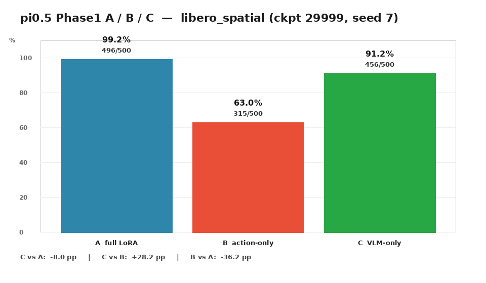
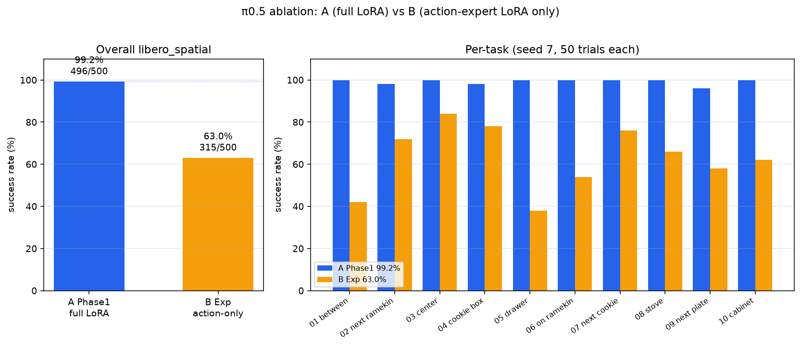
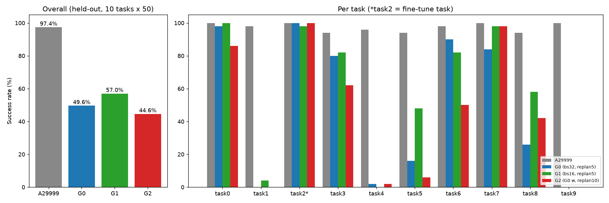

# π0.5 / LIBERO 项目总结

- 工作区：`/example/project`
- 整理时间：2026-11-06（Asia/Shanghai）
- 范围：Phase 0 官方复现、Phase 1 LoRA A/B/C 消融、PnP 自采数据微调与 held-out 全任务评测
- 一句话结论：**官方基线复现达标（495/500）；全 LoRA 微调与官方基本持平（496/500）；对称消融显示 VLM 是主要贡献方（C 456 vs B 315）；PnP 微调在未见过的初态上明显掉点（G0 248/500，G1 285/500），且 task1/4/9 出现共性损伤。**

> 说明：本文件只做汇总，不新增训练或评测；所有数字均取自 `logs/` 下已有报告、CSV、日志与审计文件。文中“官方基线”与“本实验内部对照”严格区分，详见第 6 节。

---

## 1. 目标

1. 在单张 24GB GPU 上跑通 π0.5 的官方兼容复现（Phase 0）。
2. 在复现达标后做官方兼容 LoRA 微调，并用对称消融定位 VLM / action expert 的贡献。
3. 以实验 A 权重为起点，完成一次仿真 pick-and-place 的完整闭环：公开数据参考 → 场景对齐 → 专家采数 → 清洗 → 微调 → 评测。
4. 通过 held-out 初态 + `libero_spatial` 全 10 任务，拉开 A / G0 / G1 / G2 的差异，回答 batch 与 replan 的影响。

---

## 2. 训练与评测环境

| 项 | 值 | 证据 |
|---|---|---|
| 平台 | SeetaCloud / AutoDL 训练机，经本机 SSH 助手访问 | `REQUIREMENTS.md` |
| GPU | NVIDIA GeForce RTX 4090 D，24564 MiB（24GB） | `logs/pnp-heldout-spatial-1106104308/environment.txt` |
| 数据盘 | `/root/autodl-tmp`，约 150G，多次触及容量上限 | `REQUIREMENTS.md`、`logs/report-phase1-074830.md` |
| 软件 | JAX 0.5.3、robosuite 1.4.1、MuJoCo 3.2.3、LIBERO py3.8 / 策略 py3.11 双环境 | `logs/phase0-protocol-pins.md` |
| 评测协议 | `libero_spatial`，10 任务 × 50 回合，seed 7，replan 5，wait 10，horizon 10，max_steps 220 | `logs/pnp-heldout-acceptance-evidence.md` |

24GB 显存是本项目最硬的约束：官方 `pi05_libero` 的完整 batch 256 不可行，LoRA 路线也只能用 batch 16；PnP 的 batch32 最终以梯度累积实现。

---

## 3. 做了什么

### 3.1 Phase 0：官方基线复现

- 使用官方 `pi05_libero` 权重与官方 LIBERO 评测入口，在 `libero_spatial` 上跑 500 回合。
- 结果 **495/500 = 99.0%**，高于预设阈值 ≥494/500（约 98.8%），验收通过。
- 证据：`logs/phase0-spatial-result.md`、`logs/phase0-acceptance-evidence.md`、`logs/eval-spatial-summary.txt`、`logs/eval-spatial-full.log`。

### 3.2 Phase 1：官方兼容 LoRA 与对称消融

- **A（全 LoRA）**：以 `pi05_base` 初始化，PaliGemma 2B LoRA + action expert 300M LoRA，官方 `physical-intelligence/libero` 数据（1693 episodes），训练 30,000 步、batch 16。
  - 中途在写 27k checkpoint 时磁盘满（ENOSPC）崩溃，清理旧 ckpt 后从 26000 续训到 30000，正常退出，最终 ckpt `29999`。
  - 评测 **496/500 = 99.2%**。
- **B（只训 action expert LoRA，冻 VLM）**：同数据、同预算、同评测协议，**315/500 = 63.0%**。
- **C（只训 VLM LoRA，冻 action expert，与 B 对称）**：**456/500 = 91.2%**。
- 证据：`logs/report-phase1-074830.md`、`logs/phase1-spatial-result.md`、`logs/phase1-exp-b-spatial-result.md`、`logs/phase1-exp-c-spatial-result.md`。

### 3.3 PnP：公开数据参考 → 仿真采数 → 清洗 → 微调

- **公开数据集**：选定 Hugging Face `lerobot/libero_spatial_image` 作为场景/任务对齐参考（Franka Panda、10 fps、256×256 双相机、state 8D、action 7D），任务为 `libero_spatial` task_id=2（桌中央黑碗 → 盘）。
- **场景**：复用现有 LIBERO `OffScreenRenderEnv`，物体、相机、7D OSC 动作空间与公开集对齐；成功判定用 `env.check_success()`。
- **采数**：纯几何脚本专家在接触后漂移，0/5 失败；改用**实验 A 策略作为专家**（`serve_policy`，replan 5），31 次尝试 **30 成功 / 1 失败**，仅成功轨迹入库，共 **30 episodes / 3327 帧**。
- **清洗与转换**：过滤失败、非有限值、坏形状、过短轨迹与近 noop 帧；30 → 30 episodes、3327 → 3327 帧，**未删任何轨迹**，转为 LeRobot 仓库 `local/pnp_policy_spatial_center`。
- **微调（从 A/29999 出发，2500 次更新）**：
  - **G0（内部对照）**：官方意图 batch32 / horizon10 / replan5。原生 batch32 与 micro16×2 均在首步 OOM，按授权改为 **micro8 × 累积4 = 有效 batch32**，ckpt 2499。
  - **G1**：仅改原生 batch16，ckpt 2499。
  - **G2**：复用 G0 权重与归一化，仅评测 replan 改为 10。
- 证据：`logs/pnp-dataset-and-scene.md`、`logs/pnp-clean-stats.md`、`logs/pnp-data-audit.json`、`logs/pnp-grad-accum-adapter-test.md`、`logs/pnp-g0-g1-g2-result.md`。

### 3.4 held-out 全 10 任务评测

- 目的：上一轮单任务 seen-init 四组全是 50/50（100%），天花板效应严重，无法比较。
- 做法：**不重训**，构建 500 个 held-out 初态（每任务 50 个，任务内按状态内容唯一），排除本轮 PnP 采数全部 31 次尝试用过的初态；清单在看成绩前冻结。
- 规模：4 组 × 10 任务 × 50 回合 = **2000 次正式评测**，2026-11-06 16:25 完成，**2000/2000 有效**；执行异常、未完成、重试、重复计分、缺失均为 0；16 次预跑单列不计分。
- 冻结哈希：清单 `e70042f9…f08`，协议 `b16e0bf4…e32`（完整值见证据文件）。
- 证据：`logs/pnp-heldout-acceptance-evidence.md`、`logs/pnp-heldout-spatial-1106104308/summary/report.md`、`logs/pnp-heldout-spatial-1106104308/summary/per_task.csv`。

---

## 4. 结果

### 4.1 Phase 0 与 A/B/C（`libero_spatial`，500 回合）

| 实验 | 训练范围 | 成功/总数 | 成功率 | 相对 A |
|---|---|---:|---:|---:|
| Phase 0 | 官方权重，未微调 | 495/500 | 99.0% | — |
| **A** | 全 LoRA | **496/500** | **99.2%** | — |
| **B** | 仅 action expert LoRA | **315/500** | **63.0%** | −36.2 pp |
| **C** | 仅 VLM LoRA | **456/500** | **91.2%** | −8.0 pp |

- A 与 Phase 0 只差 1 个成功（4 vs 5 次失败），在抽样噪声内，**不能据此宣称微调带来提升**。
- C 比 B 高 **28.2 pp**（+141 题），说明在该消融设置下 VLM 侧适配比 action expert 侧更关键；但两者都低于 A，不能读成“单侧训练可行”。





### 4.2 单任务 seen-init（PnP，task2，50 回合）

| 组 | 训练 batch | replan | 成功 | 平均环境步数 |
|---|---|---:|---:|---:|
| A29999（参考） | — | 5 | 50/50（100%） | 101.86 |
| G0 | micro8×4 = 32 | 5 | 50/50（100%） | 105.20 |
| G1 | 原生 16 | 5 | 50/50（100%） | 99.60 |
| G2 | 复用 G0 | 10 | 50/50（100%） | 102.20 |

四组完全饱和，**该协议下看不到 batch 或 replan 差异**；这正是后续改用 held-out 初态 + 全 10 任务的原因。

### 4.3 held-out 全 10 任务（2000 次正式评测）

| 组 | 成功/总数 | 成功率 | 相对 G0 |
|---|---:|---:|---:|
| A29999（微调前参考） | 487/500 | 97.4% | +47.8 pp |
| **G0**（内部对照，有效 batch32） | **248/500** | **49.6%** | — |
| **G1**（batch16） | **285/500** | **57.0%** | **+7.4 pp** |
| **G2**（同 G0 权重，replan10） | **223/500** | **44.6%** | **−5.0 pp** |

合计 1243 次成功；757 次在 220 步上限被判失败（不是执行异常）。



逐任务成功率（每格 50 回合）：

| task | A29999 | G0 | G1 | G2 | 备注 |
|---:|---:|---:|---:|---:|---|
| 0 | 50/50 | 49/50 | 50/50 | 43/50 | G2 −12 pp |
| 1 | 49/50 | **0/50** | 2/50 | 0/50 | 微调后几乎全失 |
| 2 | 50/50 | 50/50 | 49/50 | 50/50 | 采数任务，仍接近饱和 |
| 3 | 47/50 | 40/50 | 41/50 | 31/50 | G2 −18 pp |
| 4 | 48/50 | **1/50** | 0/50 | 1/50 | 微调后几乎全失 |
| 5 | 47/50 | 8/50 | 24/50 | 3/50 | G1 +32 pp |
| 6 | 49/50 | 45/50 | 41/50 | 25/50 | G2 −40 pp |
| 7 | 50/50 | 42/50 | 49/50 | 49/50 | |
| 8 | 47/50 | 13/50 | 29/50 | 21/50 | G1 +32 pp |
| 9 | 50/50 | **0/50** | 0/50 | 0/50 | 微调后全失 |

**读法：**

1. **微调在 30 条自采数据上明显损伤了通用能力**：task1/4/9 三组微调合计仅 4 次成功，而 A29999 有 147/150。
2. 采数任务 task2 仍接近饱和，说明模型确实学到了这条轨迹，但发生了过拟合/遗忘。
3. G1 的增益集中在 task5、task8（各 +32 pp），但 task6 掉 8 pp；**不能把 +7.4 pp 简单归因为 batch**（见风险）。
4. replan 从 5 提到 10（G2）总体更差（−5.0 pp），task3/task6 分别 −18/−40 pp；在本树中这是同步 replan，不是异步 RTC。

---

## 5. 关键文件与查看方式

### 汇总与图表（本仓库）

| 内容 | 路径 |
|---|---|
| 本总结 | `PROJECT_SUMMARY.md` |
| A/B/C 柱状对比 | `figures/exp_a_b_c_spatial.png` |
| A vs B 逐任务 | `figures/exp_a_vs_b_spatial.png` |
| B 训练 loss | `figures/exp_b_loss_curve.png` |
| C 训练 loss | `figures/exp_c_loss_curve.png` |
| held-out 总体 + 逐任务 | `figures/pnp_heldout_compare.png` |
| held-out 总表 | `logs/pnp-heldout-spatial-1106104308/summary/report.md` |
| held-out 40 行明细 | `logs/pnp-heldout-spatial-1106104308/summary/per_task.csv` |

### 报告与证据

| 阶段 | 用户向报告 | 验收/证据 |
|---|---|---|
| Phase 0 | — | `logs/phase0-acceptance-evidence.md`、`logs/phase0-spatial-result.md` |
| Phase 1 A | `logs/report-phase1-074830.md` | `logs/phase1-spatial-result.md`、`logs/phase1-eval-spatial-summary.txt` |
| Exp B | `logs/report-exp-b-045139.md` | `logs/phase1-exp-b-acceptance-evidence.md` |
| Exp C | `logs/report-exp-c-000413-out.md` | `logs/phase1-exp-c-acceptance-evidence.md` |
| PnP 单任务 | `logs/report-a-pnp-100355.md` | `logs/pnp-acceptance-evidence.md`、`logs/pnp-final-verification.json` |
| PnP held-out | `logs/report-pnp-heldout-spatial-172624.md` | `logs/pnp-heldout-acceptance-evidence.md`、`logs/pnp-heldout-code-packet.md` |

### 原始数据入口（本地证据包 `logs/pnp-heldout-spatial-1106104308/`）

- 逐 trial 事件：`trials/`（4000 个 start/result 事件）
- 冻结清单与协议：`heldout/manifest.json`、`protocol.json`
- 视频索引：`local-video-index.md`（正式 67 条 / 5895 帧，预跑 8 条 / 590 帧，覆盖各组×任务×成功/失败类别）
- 独立复算：`local-independent-audit.json`；全资产校验：`local-package-audit.json`、`transfer-audit.json`、`final-protocol-verify.log`
- 训练 loss：`logs/plots/pnp_g0_wandb_loss_curve.png`、`logs/plots/pnp_g1_wandb_loss_curve.png` 及同名 CSV

### 本地复算（不跑策略/仿真）

```bash
/usr/bin/python3 logs/pnp-heldout-spatial-1106104308/local_package_audit.py
```

需要本地有 NumPy、Pillow、FFmpeg；该脚本只读本地记录，复算 2000 条结果、4239 个文件、冻结脚本与视频帧。

> 远端原始日志/权重仍在训练机（`/root/autodl-tmp/...`），需通过既有 SSH 助手读取；本总结不包含任何凭据。大权重未回拷到本仓库。

---

## 6. 官方基线与本实验的差别（重要）

| 维度 | 官方 / Phase 0 | 本项目实验 |
|---|---|---|
| 权重 | 官方 `pi05_libero` | A：官方兼容 LoRA（30k）；B/C：在其上做单侧 LoRA 消融；PnP：从 A 再微调 |
| 训练 batch | PnP 对照参考 `pi05_libero_lora` 的 `batch_size=32`；不等同于完整 `pi05_libero` 训练配置（完整官方训练未复跑） | A/B/C 用 batch 16（24GB 限制）；G0 用 micro8×4 等效 32；G1 原生 16 |
| 数据 | `physical-intelligence/libero`（1693 episodes） | A/B/C 同官方数据；PnP 用自采 30 条专家轨迹 |
| state 编码 | xyz + 轴角(3) + 双指(2) | **PnP 沿用 xyz + 四元数(4) + 单指(1)，非官方** |
| 评测初态 | 官方默认初态 | PnP held-out：500 个任务内唯一状态，排除 31 次采数初态 |
| 结果定位 | 可与官方阈值对标 | **内部对照，不宣称官方 benchmark** |

因此：

- Phase 0 的 99.0% 是官方复现口径；
- A 的 99.2% 是官方兼容 LoRA 口径，与 Phase 0 差 1 题，属噪声；
- PnP 的 G0/G1/G2 与 A29999 的数字只能做**内部横向比较**，不能与论文榜单直接对齐；
- A29999 与 PnP 微调组之间还混有数据、归一化差异，不是干净的单变量对照。

---

## 7. 过程中遇到的问题与处置

| 问题 | 影响 | 处置 | 证据 |
|---|---|---|---|
| 数据盘写满（ENOSPC） | Phase1 A 在 27k checkpoint 崩溃 | 删旧 ckpt / 可重建缓存，从 26000 续训到 30000 | `REQUIREMENTS.md`、`logs/report-phase1-074830.md` |
| G0 原生 batch32 / micro16×2 OOM | 无法按原样训练 G0 | 经授权改为 micro8×累积4，保留失败日志与 W&B run，不伪造曲线 | `logs/pnp-executor-error-gate.md`、`logs/pnp-g0-g1-g2-result.md` |
| W&B 外网 403 | 无法在线同步 | 全程 `WANDB_MODE=offline`，从本地 `.wandb` 解析 loss；未泄露密钥 | `REQUIREMENTS.md`、`logs/pnp-code-packet.md` |
| 本机 SSH socket 被限制 | 早期无法连训练机 | 改用既有 `ssh-wrapper` 助手；未提权、未绕过 | `logs/phase1-connection-error.txt`、`logs/pnp-executor-blocker.md` |
| py3.8 无 `importlib.metadata.packages_distributions` | held-out 环境采集报错，正式未启动 | 停 error 门禁，改为逐包 `version()` 并让采集失败阻断启动 | `error.log`、`logs/pnp-heldout-error-gate.md` |
| 证据回拷时远端 `python3` 不在 PATH（rc=127） | 打包中断 | 使用绝对解释器路径后重跑，4239 文件 SHA256 全部核对通过 | `logs/pnp-heldout-package-error-gate.md`、`logs/pnp-heldout-acceptance-evidence.md` |
| 评测退出时 EGL 清理报错 | 仅退出阶段噪音 | 退出码 0，不影响计分；已在报告中披露 | `logs/phase0-spatial-result.md` |

---

## 8. 风险与限制

1. **非官方 benchmark**：PnP 的 state 编码（xyz+四元数+单指）与官方（xyz+轴角+双指）不同，数字只用于内部比较。
2. **held-out 的范围有限**：只相对本轮 31 次 PnP 采数排除，不宣称相对 A 的历史训练数据隔离；task2 的 50 个初态中有 31 个是按预写规则用 native reset 生成的。
3. **G1 的 +7.4 pp 不能归因于 batch**：G0 是梯度累积等效 32，样本暴露约 80k，G1 约 40k，随机数路径也不同；且 A 与微调组之间还有数据/归一化差异。
4. **G2 不是异步 RTC**：只是把同步 replan 从 5 改成 10，不能用来评价 RTC 收益。
5. **单 suite、单 seed、单轮**：每任务 50 回合，单任务成功率在 50% 附近时抽样标准误约 ±7 pp（总体 500 回合约 ±2.2 pp）；不能外推到 Object/Goal/Long，也不构成显著性结论。
6. **微调副作用未归因**：task1/4/9 的崩塌尚不清楚是抓取、定位还是超时；目前只有视频可查，未逐条分类。
7. **loss 曲线不完整**：每 50 次更新记录一次，末点 step 2450，最后 49 次更新未记录，不能当最终收敛值。
8. **交付状态**：reporter 已完成总结，协调者负责将总结、图表和报告打包提交。GitHub 连接器对本仓库返回 `scm_repo_not_accessible`；本轮远端发布待仓库访问授权恢复，不宣称已经推送。

---

## 9. 建议的下一步（均未执行）

1. **归因 task1/4/9**：抽查失败视频，按抓取失败 / 定位失败 / 220 步超时分类，这是解释“微调伤通用能力”的关键。
2. **复核 G1 的 task5/task8 增益**：看视频确认是真实行为变化，还是初态/随机性造成的。
3. **若要坐实 batch 效应**：做等样本暴露、原生 batch32（更大显存）的对照重训；不做也不影响本轮“G1 优于 G0”的现象描述。
4. **多 seed / 多 suite**：至少补一个 seed 报均值±方差；有余力再扩 `libero_object` / `libero_goal`。
5. **默认配置建议**：若只选一个，当前 held-out 数据支持 **G1（batch16）+ replan5**；但需带着“单 seed”限定。
6. **交付前**：经确认后提交 `PROJECT_SUMMARY.md`、`figures/` 与新增报告，并推送 GitHub；保留证据包与冻结哈希以便复现。
7. **可选**：若要谈 RTC，需要实现异步推理路径，用推理时延/吞吐单独评估，不能沿用本轮 G2。

---

## 10. 结论

- 官方复现达标，全 LoRA 微调与官方持平；VLM-only 明显优于 action-only，方向符合“VLM 表征更关键”的预期。
- PnP 闭环跑通，但 30 条自采数据不足以支撑通用性：seen-init 全 100%，held-out 掉到 49.6%（G0）。
- batch16（G1）在 held-out 上比等效 batch32（G0）高 7.4 pp，replan10（G2）低 5.0 pp；因样本暴露与随机数不同，**只能作为现象记录，不能作为因果结论**。
- 最大的未解问题是 task1/4/9 的共性崩塌；下一步应优先做失败归因，而不是继续加实验。

## 数据与视频发布

自采数据、格式、下载和校验说明见 [DATA.md](DATA.md)；视频目录计划为 `media/`。

## 最终检查点归档

A/B/C 的最终 29999 与 PnP G0/G1 的最终 2499 已归档至 [ckpt-v1 Release](https://github.com/nayutazyc01-ui/pi05-libero/releases/tag/ckpt-v1)。G2 共用 G0 权重。每组包含完整 `params` 和 `assets/norm_stats`，不含优化器 `train_state`，用于推理和评测，不是完整断点续训备份。下载、分卷重组、SHA-256 校验与 openpi 加载步骤见 [CKPT.md](CKPT.md)。
